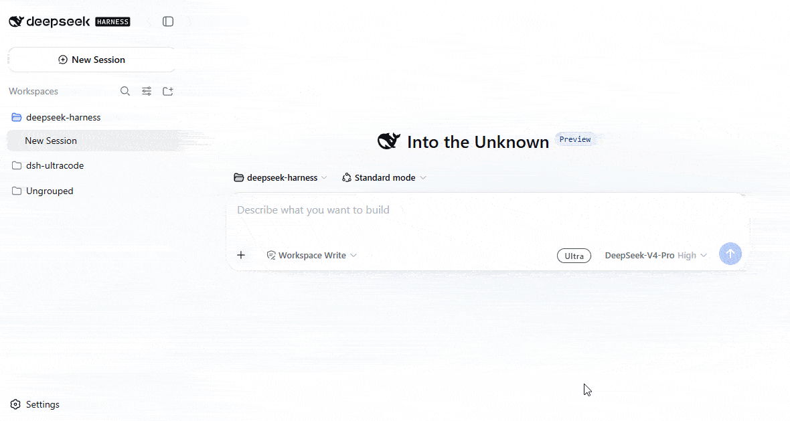

<p align="right">
  <strong>English</strong> · <a href="./README_ZH.md">简体中文</a>
</p>

# DeepSeek Harness Ultracode

<p align="center">
  <a href="https://www.npmjs.com/package/dsh-ultracode"></a> <a href="./LICENSE"></a> 
</p>

## One switch. Maximum depth.

`dsh-ultracode` adds an **ultra tier** to DeepSeek Harness: one per-session switch that pins every model request to the serving model's deepest reasoning effort and activates a standing orchestration policy — workflow fan-out by default on substantive tasks, adversarial verification before reporting, context hygiene. Delegated children inherit the tier as a worker policy (deep effort, adversarial verification) without the workflow mandate, so orchestration stays at the top.

Modeled on Claude Code's `ultracode` tier: the tier's substance is the standing orchestration policy, not a deeper reasoning parameter. Works on any provider whose adapter declares efforts from the shared vocabulary — DeepSeek (`max`), GLM / Kimi routes (`high` or `max`, whichever the model declares), or fully custom OpenAI-compatible routes.

<p align="center">
  
</p>

<p align="center">
  <em>Toggle it from the composer: a <strong>ULTRA</strong> chip appears next to the model selector, and while active the composer card carries an animated rainbow border.</em>
</p>

## What it changes

| Capability | What it changes |
| --- | --- |
| **Per-session effort tier** | One switch pins every model request to the serving model's deepest declared effort (`auto`), or a literal configured value. |
| **Orchestration policy** | A deployment-owned prompt section rides the system prompt while active: standing workflow opt-in, adversarial verification, narrow-the-wave retries on provider limits — for the top-level session. |
| **Composer chip + rainbow border** | A ULTRA chip in the composer bar; the composer card glows while the tier is in force (static under `prefers-reduced-motion`). |
| **Picker consistency** | The host records the effort through `agent.model.select()`, so the native picker follows the same durable selection as model requests. |
| **Delegation-aware** | Spawn subagents inherit the effective state through the delegation chain — the effort pin and a worker policy (`childSection`), never the workflow mandate; forks inherit through their seeded prefix and freeze there. |

## Install

> [!NOTE]
> Requires [DeepSeek Harness](https://github.com/deepseek-ai/deepseek-harness) `0.2.2-alpha.2` or a compatible release (`@deepseek-ai/dsh-*@^0.2.2-alpha.2`) and Node.js `>=24.9.0`.

### npm

```sh
dsh plugin --profile <name> add dsh-ultracode
```

### Build from source

```sh
git clone https://github.com/BackMountainBird/dsh-ultracode.git
cd dsh-ultracode
pnpm install
pnpm build
dsh plugin --profile <name> add .
```

Run `pnpm build` again after changing the source. The local plugin install remains linked to this checkout.

Validate the composed profile and restart DSH:

```sh
dsh --profile <name> --dump-config
dsh --profile <name> web
```

Then switch the tier on — from the composer chip, or directly:

> /ultra
>
> Use ultra mode to audit every integration point of this repository against its pinned dependencies, with parallel verification.

Leave with `/ultra off` (or click the chip again).

## How it works

1. **The switch is one command.** `/ultra` (and `/ultra off`) execute through the harness command runtime, which appends the `command/run` session event *before* the handler runs. That event is the durable switch state, so resume and replay restore it, and the last command wins. A validated, ignorable `plugin:dsh-ultracode/effort-pin` record tracks which explicit selection the plugin owns; reload and resume can release an inherited pin without overwriting a later manual choice.
2. **The policy rides the system prompt, gated by delegation depth.** While active, an `ultra:policy` section renders into every request. The top-level session (`delegationDepth` zero) renders `section`: the orchestration policy (standing workflow opt-in, adversarial verification, context hygiene, narrow the wave when a provider's concurrency limit times parallel subagents out). A delegated child (`delegationDepth` above zero) renders `childSection` instead: a worker policy that keeps the workflow tool's default opt-in rule — an inherited mandate would make every child fan out workflows of its own, with no delegation-depth budget on the workflow path to stop it.
3. **The effort is selected before request admission.** The command and `agent/created` listener record the serving model's deepest declared effort through `agent.model.select()`. `auto` (default) ranks the shared `off…max` vocabulary; a literal value pins exactly and fails if the adapter does not declare it. An `agent/pre-step` check corrects manual changes and inherited-state changes. If the step already captured another effort, the plugin preserves its claimed messages, cancels that preparation, and wakes a new turn with the corrected selection and a notice. This may add an aborted preparation to the log; it sends no model request under the stale effort. DSH `0.2.2` rejects effort changes in the deprecated `agent/request` waterfall.
4. **Delegation inherits it.** Spawn children walk the delegation chain (each child's `parentSession`, resolved against the live session store) and get the pin and the worker policy — the effort resolving against the *child's* model. Fork children (`header.isSeeded`, including an empty seed) inherit only through their seeded completed-turn prefix; a parent's later switch never reaches an already-spawned branch.
5. **The model is told.** Each genuine switch injects one notice user message attributed to the `dsh-ultracode` producer, so the model learns the change without diffing prompt sections.
6. **The picker follows.** The host's durable model selection updates the native effort picker. The chip only executes the command; it makes no second model-selection request that could overwrite a fixed `effort` configuration. Switching off clears the explicit effort and restores the adapter default.
7. **The web half is one client bundle.** A ULTRA chip occupies the composer's `conversation.input.right` seat; state rides the host-computed `ultra` projection (zero client-side ultra state), and while active the chip marks the composer card — an injected stylesheet renders the rainbow border. The bundle ships as a closure factory (`window.__ModuleLoader__.load`) with platform externals resolved through the loader's module table.

## Configuration

Profile row `dsh-ultracode`:

```yaml
- id: dsh-ultracode
  config:
    effort: auto
```

| Field | Default | Meaning |
| --- | --- | --- |
| `section` | built-in policy text | Rendered as the `ultra:policy` prompt section while active, for top-level sessions (`delegationDepth` zero) |
| `childSection` | built-in worker policy | Rendered instead of `section` for delegated children (`delegationDepth` above zero); the default keeps the workflow tool's opt-in rule so the mandate does not recurse |
| `effort` | `auto` | `auto` pins each request to the deepest effort the serving model declares; a literal value must be one of the serving adapter's declared efforts (fails loud otherwise) |
| `promptSectionOrder` | `120` | Prompt-section order |

## Boundaries

- The switch uses the harness-owned `command/run` event; pin ownership uses an ignorable plugin record, outside the released session-event vocabulary. The tool catalog never changes across modes (request-cache stability).
- Inheritance only ever adds: subagent sessions have no user command surface, so children cannot opt out.
- The orchestration mandate does not recurse: children render `childSection` (the worker policy), keeping the workflow tool's default opt-in rule — only the top-level session orchestrates by default.
- Manual effort changes made mid-ultra realign before the next request is admitted; the host's recorded selection drives both requests and the native picker. A request already prepared before a switch keeps its captured selection.
- Fan-out capacity belongs to the provider: the default policy tells the model to retry timed-out parallel work as a narrower wave instead of abandoning it.
- Ultra does not touch plan mode: the two are independent logged states and compose freely (`/plan` + `/ultra` = max-effort planning under plan's read-only constraints).

## Development

```sh
pnpm install
pnpm run typecheck
pnpm run build
pnpm run verify
```

Host half in `src/` (command, durable effort selection, step-admission check, prompt section, session projection, delegation-chain walk); browser half in `src/client/` (composer chip, rainbow stylesheet, command transport). DSH peer floors are `^0.2.2-alpha.2`; devDependencies pin `0.2.2-alpha.2`, with Cordis `4.0.6-alpha.1` and Schemastery `3.18.6-alpha.1`. Verification runs offline checks over the built host/client artifacts and the released DSH agent loop with a mock adapter.

## License

[MIT](./LICENSE)
